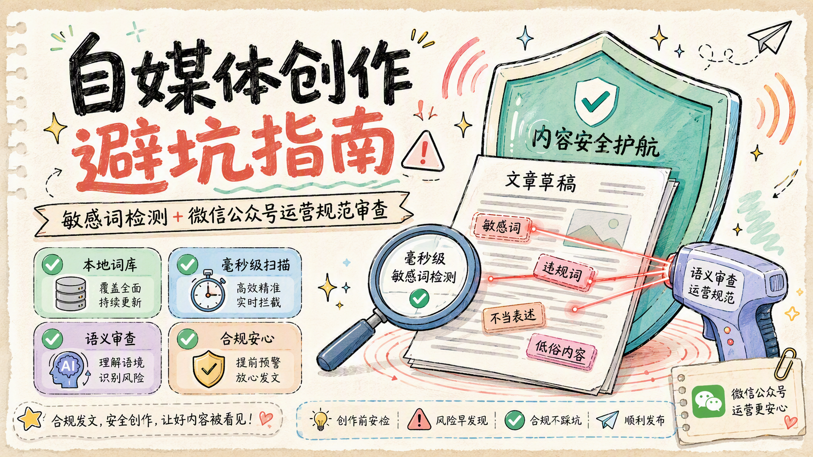

# text-check-skill

> 中文敏感词检测 + 微信公众号运营规范审查 skill，自媒体创作避坑



## 安装

```bash
npx skills add https://github.com/undsky/text-check-skill.git
```

## 能力

- **敏感词检测**：基于 Sensitive-lexicon 词库扫描文件，报出敏感词与行号
- **公众号运营规范审查**：依据本地保存的《微信公众平台运营规范》，逐条审查内容违规风险，给出条款号、风险等级与修改建议

## 使用示例

直接在对话框中输入指令

```bash
检测 C:\Users\user\Downloads\test\1.md 是否有敏感词
```

```bash
检查 C:\Users\user\Downloads\test\1.md 能不能发公众号
```

## 规范来源

《微信公众平台运营规范》抓取自 <https://mp.weixin.qq.com/mp/opshowpage?action=newoplaw>，存于 `assets/rules/wechat-op-rules.md`，抓取日期见文件 frontmatter。

| 公众号                                       | QQ群                                          |
| -------------------------------------------- | --------------------------------------------- |
|  |  |

## 鸣谢

[ Sensitive-lexicon](https://github.com/konsheng/Sensitive-lexicon)
