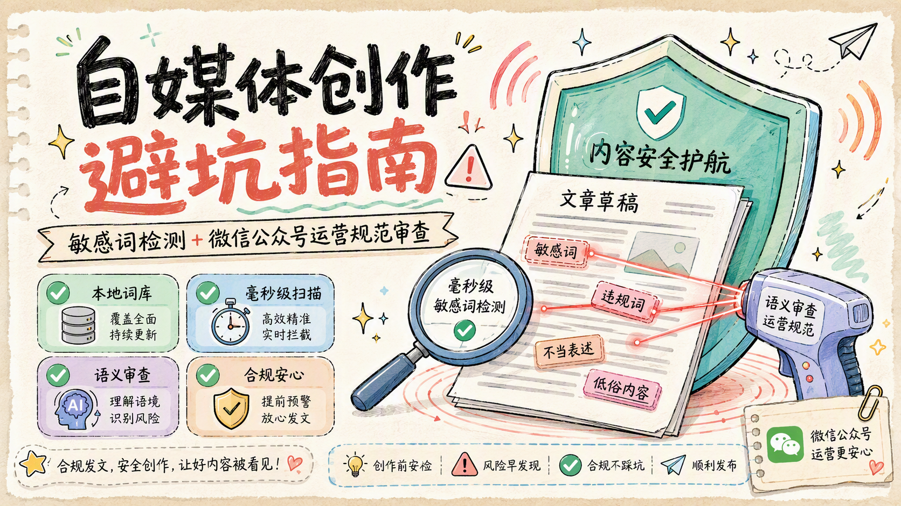

# text-check-skill

> 中文敏感词检测 + 微信公众号 / 闲鱼社区规范审查 skill，自媒体创作与闲置发布避坑



## 安装

```bash
npx skills add https://github.com/undsky/text-check-skill.git
```

## 能力

- **敏感词检测**：基于 Sensitive-lexicon 词库扫描文件，报出敏感词与行号
- **公众号运营规范审查**：依据本地保存的《微信公众平台运营规范》，逐条审查内容违规风险，给出条款号、风险等级与修改建议
- **闲鱼社区规范审查**：依据本地保存的闲鱼规则中心 5 项核心规范，逐条审查闲鱼商品文案、帖子与互动内容的违禁风险、资质要求及引导站外等违规点

## 使用示例

直接在对话框中输入指令

```bash
检测 C:\Users\user\Downloads\test\1.md 是否有敏感词
```

```bash
检查 C:\Users\user\Downloads\test\1.md 能不能发公众号
```

```bash
检查 C:\Users\user\Downloads\test\1.md 能不能发闲鱼
```

## 规范来源

- **微信公众号**：《微信公众平台运营规范》抓取自 <https://mp.weixin.qq.com/mp/opshowpage?action=newoplaw>，存于 `assets/rules/wechat-op-rules.md`。
- **闲鱼**：抓取自 [闲鱼规则中心](https://h5.m.goofish.com/wow/moyu/moyu-project/doc/pages/v3Lv4OO6VbJS)，存于 `assets/rules/xianyu/`：
  - `assets/rules/xianyu/convention.md` — 《闲鱼社区公约》
  - `assets/rules/xianyu/info-interaction.md` — 《闲鱼社区信息发布与互动行为管理规范》
  - `assets/rules/xianyu/prohibited.md` — 《闲鱼社区违禁信息管理规范》
  - `assets/rules/xianyu/qualification-service.md` — 《闲鱼社区资质类商品与特定服务管理规范》
  - `assets/rules/xianyu/community-management.md` — 《闲鱼社区管理规范（试行）》

抓取日期均见各文件 frontmatter 的 `fetched` 字段。

| 公众号                                       | QQ群                                          |
| -------------------------------------------- | --------------------------------------------- |
|  |  |

## 鸣谢

[ Sensitive-lexicon](https://github.com/konsheng/Sensitive-lexicon)
